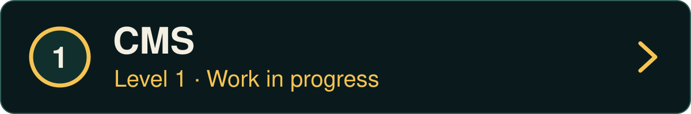
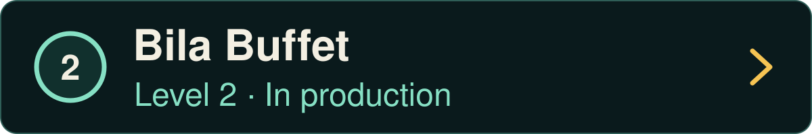
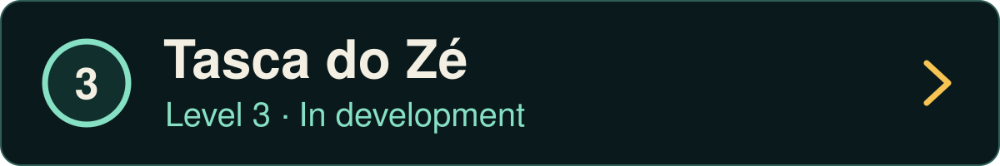
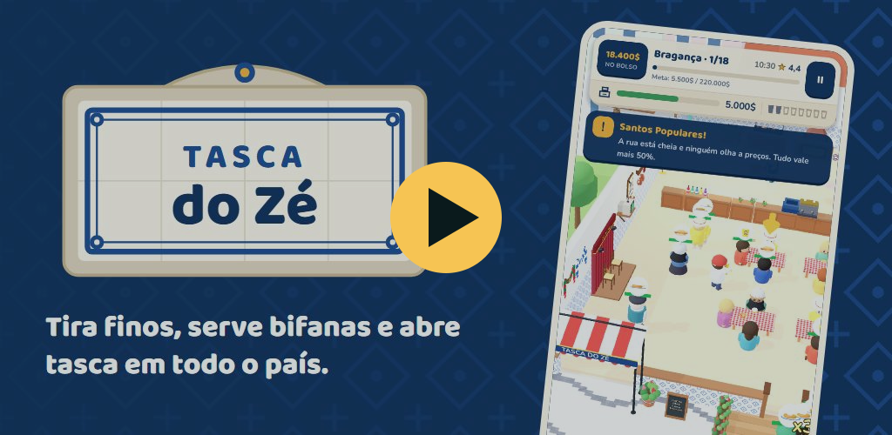

  

<b>Full Stack Developer · Backend-focused</b>

Based in Portugal and working professionally since April 2025. I build web applications with PHP/Symfony on the backend and React on the frontend, and I'm focused on growing as a backend engineer: API design, data modelling, testing and writing secure code.

## Levels

Content management system with a Symfony REST API and a Vue 3 admin dashboard. JWT authentication, pages built from content blocks, scheduled publishing and revision history.\
*Symfony 6.4 · Doctrine ORM · MySQL · Vue 3 · Pinia · Tailwind CSS*

Website for a buffet restaurant, live in production and built solo. A responsive, multilingual single page; the daily and weekly menus are managed in the back office, with online reservations on a calendar, Google reviews with a fallback, SEO and image optimisation, and CI with automatic deploys.\
*Symfony 7.3 · Twig · EasyAdmin*

A free mobile game for Android, made solo: you inherit your grandfather's tasca in Bragança and open tascas across the country. Coming soon to Google Play.\
*Godot 4.7*

<!-- Trailer cover: uncomment when the portfolio is live, with its address in place of PORTFOLIO_URL.

-->

## Inventory

**Backend**\
    

**Frontend**\
   

**Tooling**\
  

I have also used Laravel in an academic project.

## Quest log

- **Main quest:** strengthening my backend skills: Symfony, automated testing and API design.
- **Side quest:** Tasca do Zé, coming soon to Google Play.
- **Long-term:** application security and AI security.

## Party up

