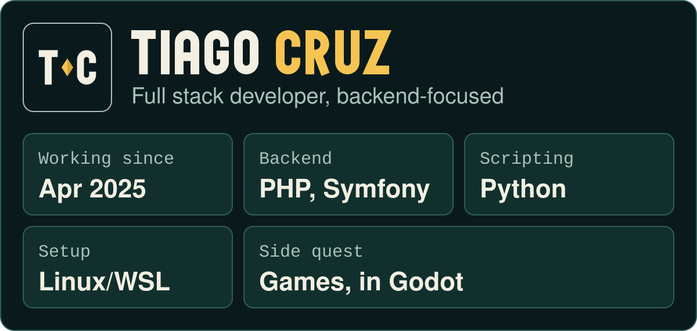

  

  

## Player profile

I studied Communication and Multimedia at UTAD, where I built my first web applications, and since April 2025 I've been a full stack developer at Fullscreen, with a focus on the backend. I've played games since I was a kid, and I always wanted to make one of my own.

## Levels

Content management system with a Symfony REST API and a Vue 3 admin dashboard. JWT authentication, pages built from content blocks, scheduled publishing and revision history.\
*Symfony 6.4 · Doctrine ORM · MySQL · Vue 3 · Pinia · Tailwind CSS* · [Source on GitHub](https://github.com/TiagoCruz1224/CMS)

Website for a buffet restaurant, live in production and built solo. A responsive, multilingual single page; the daily and weekly menus are managed in the back office. It also has Google reviews with a fallback, SEO and image optimisation, CI with automatic deploys, and a reservation calendar (built, switched off for now: bookings go by phone or WhatsApp).\
*Symfony 7.3 · Twig · EasyAdmin* · [Visit the live site](https://bilabuffet.rf.gd/)

A free mobile game for Android, made solo: you inherit your grandfather's tasca in Bragança and open tascas across the country. Coming soon to Google Play.\
*Godot 4.7* · [Game page](https://tiagocruz1224.github.io/tascadoze-site/)

## Inventory

**Backend**\
    

**Frontend**\
  

**Tooling**\
  

I have also used Laravel in an academic project.

## Quest log

- **Main quest:** strengthening my backend skills: Symfony, automated testing and API design.
- **Side quest:** Tasca do Zé, coming soon to Google Play.
- **Long-term:** application security and AI security.

## Party up

